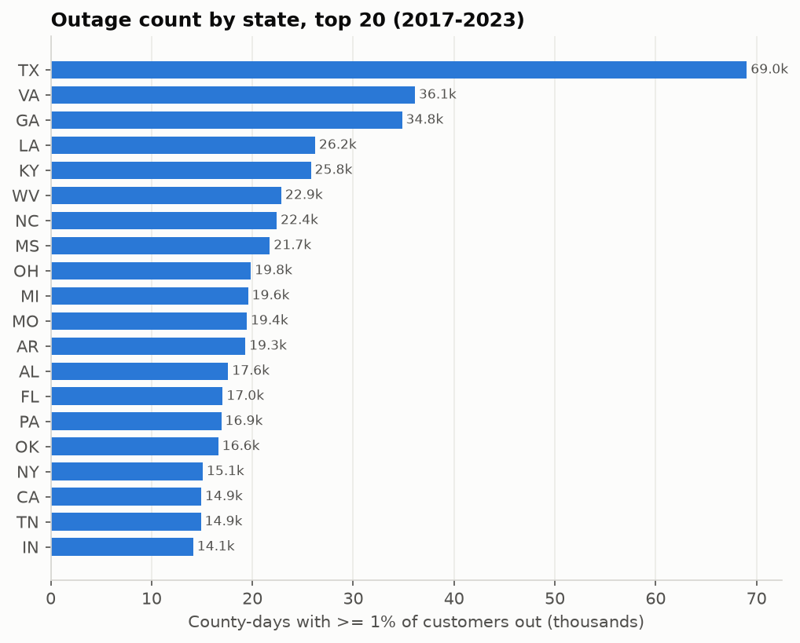
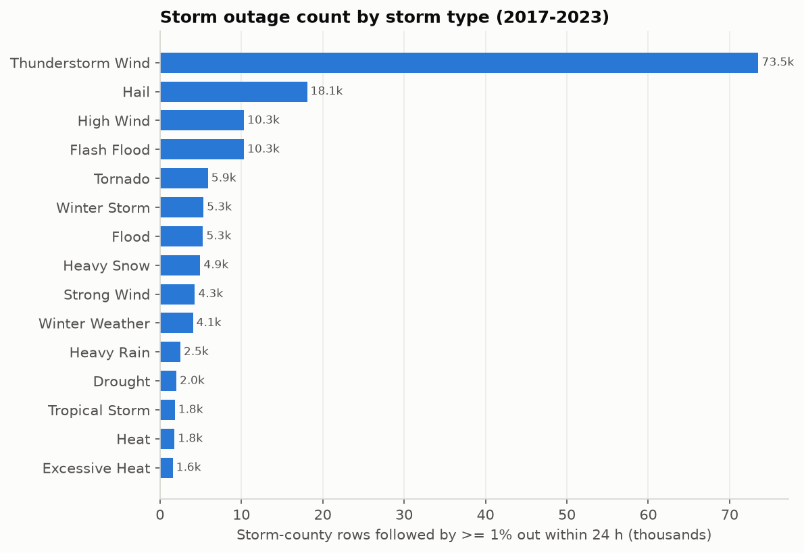
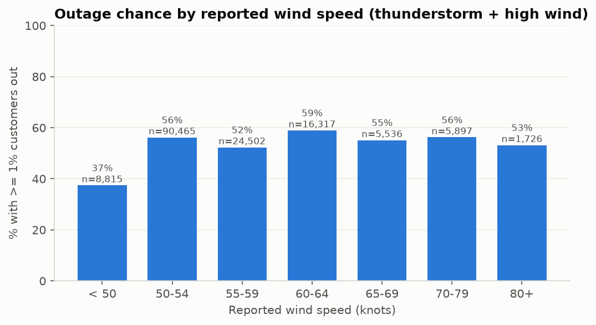
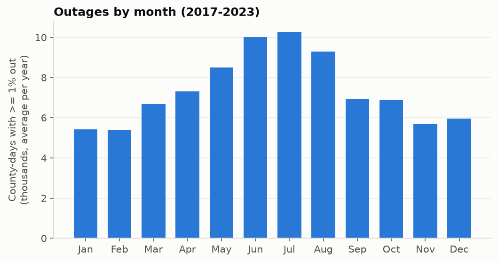

# 03 – EDA: Storms and Power Outages (training years 2017–2023)

Notebook: [notebooks/03_eda.ipynb](../notebooks/03_eda.ipynb) · Figures: [reports/figures/](figures/) · Run 2026-10-25

---

## [GOAL]

Explore the cleaned tables to learn:
- **where** outages happen and **which storms** cause them
- **how severe** storm outages are and **how fast** they peak
- **what this means for the target definition and prediction unit** that are still open

Only **training years (2017–2023)** are used, so the outcomes in validation (2024) and test (2025) stay unseen.

**Working definitions for EDA (provisional, not the final target):**
- **Significant outage:** at least **1% of a county's customers out**.
- **Storm outage:** a significant outage within **24 h after a storm starts**, in a county that EAGLE-I was tracking that day. That gives 452,668 storm × county rows.
- **Baseline:** the same county and hours **one week earlier**, as a "normal week" comparison.

---

## [FINDINGS]

### 1. Outage count by state

Texas leads by far (69 K county-days with ≥1% out), followed by VA, GA, LA and KY. **Raw counts mostly reflect how many counties a state has** (Texas has 254), so Figure 2 shows a rate instead.

### 2. Outage rate by state

Per county per year, **WV (60 days), LA (59) and ME (56)** have the most outage days. These are likely forested, rural states with a lot of overhead lines, though this data can't confirm that. Most other states fall around 33–42 days. **Puerto Rico (279) and the Virgin Islands (81)** are off the scale. Their grids have chronic problems, including the long recovery after Hurricane Maria in 2017. They should be flagged or modeled separately.

> **Data fix found here:** NC first came out on top (66 days). That turned out to be a bad EAGLE-I customer count (MCC): 0.17 customers per person vs ~0.5 everywhere else. NC now uses the Census-based estimate (see the 02 summary), and its rate is 33.
>
> **Re-run in step 04:** 21 more counties with broken MCC values were switched to the Census estimate (see the 02 summary). The numbers here are from that re-run and moved only slightly (Texas 72 K → 69 K).
>
> **Small-county effect:** 1% of a small rural county is only a few dozen customers, so small counties cross the threshold more easily. A target that combines a percent rule with a minimum customer count would reduce this.

### 3. Storm outage count by storm type

**Thunderstorm wind causes the most storm outages by far: 74 K storm-county outages, about 4× hail (18 K).** High wind, flash flood, tornado and the winter types follow. Thunderstorm wind is both very common and very damaging, so it will dominate the training data.

### 4. Chance of an outage by storm type

| Storm type | Chance of ≥1% out within 24 h | Normal week |
|---|---|---|
| Tropical storm | **83%** | 9% |
| Thunderstorm wind | **62%** | 10% |
| Tornado | **60%** | 8% |
| Ice storm | 52% | 7% |
| Hail | 33% | 8% |
| Winter weather / drought / heat | 7–16% | 8–12% |

- **Every damaging storm type is far above the normal-week baseline (~8%), so storm type alone is a strong feature.**
- Drought and heat barely differ from baseline. They can probably be dropped as triggers.
- Overall, **35% of storm-county rows have an outage, vs 8% in a normal week.**

### 5. Wind speed

- The outage chance jumps from **37% below 50 knots to ~53–59% at 50+ knots**, then **stays flat**. Reported wind speed is a weak signal beyond whether a report crossed the severe-wind criterion.
- Part of the reason: NOAA mainly records wind reports at or above 50 knots, so the values bunch up near that level.
- **Expect more signal from how many storm reports hit a county and its neighbours** than from the speed of a single report.

### 6. How severe are storm outages?

The share of storm-county rows reaching each outage level within 24 h:

| Level | After a storm | Normal week |
|---|---|---|
| ≥0.1% out | 59% | 30% |
| **≥1% out** | **36%** | 9% |
| ≥5% out | 17% | 2% |
| ≥10% out | 10% | 1% |

- **The gap between storms and normal weeks is largest in relative terms at higher thresholds.** At 5%+ a storm is ~8× more likely than a normal week to cause an outage. At 1% it is ~4× more likely.
- **Trade-off for the target:** 1% gives balanced classes (36% positive), but more noise from normal background outages. 5% is a cleaner "real storm outage" signal, but only 17% of rows are positive.

### 7. When does the outage peak?

**Outages peak fast.** The median peak is **4 hours** after the storm starts. 57% peak within 6 h and **83% within 24 h**. The long tail after 24 h comes mostly from slow, multi-day events (winter storms and tropical systems). **A 24 h window catches most storm outages.**

### 8. Seasonality

- **Outages peak in June–July** (about twice the Jan–Feb level) and are lowest in Jan–Feb.
- The chance of an outage *after a storm* follows the same shape: **47% in June vs 22% in Feb**. Summer storms (convective wind) are more damaging per event than winter ones.
- **Month should be a feature.**

### Additional findings that matter for modeling
- **Most outages have no storm record.** Only **20%** of significant outage county-days have a NOAA storm event in that county within ±1 day, and **32%** even when ≥10% of customers are out.
  - Some outages have non-weather causes (equipment failures, planned shutoffs, wildfire safety shutoffs).
  - Some storms are missing from NOAA (it records notable reports only), and the zone-to-county mapping is imprecise.
  - **"Given a storm" models only a subset of all outages.** That's fine for the stated goal, but the model can't speak to outages without a storm record.
- **Zone-coded storms are much weaker signals.** Storms coded by county lead to an outage **48%** of the time, vs **21%** for zone-coded storms (high wind, winter, tropical) spread over every county in the zone. Partial-county zones (20%) look about the same as whole-county zones (21%). How a storm is located should be a feature, or zone storms need their own handling.
- **Overlapping storms:** one storm system creates many events in the same county over a few hours (many thunderstorm wind reports). Their windows share the same outage peak, so rows are not independent. This supports **merging rows into one county × storm-episode or county × day unit.**
