# Storm-to-Outage: Exploratory Data Analysis of the ML-Ready Dataset

DSCI 4350 capstone · Georgia State University · Fall 2026 
Question: <b>given a storm, what is the probability that a US county loses power?</b> 
Dataset version: Hugging Face <code>DSCI-Capstone/county-outage-data</code> @ <code>5c01325</code> · code: notebooks 01–04 (build), 06 (this EDA)

**How to read this report.** Section 1 lists the findings. Sections 2–7 give the evidence for each. Section 8 summarises the earlier EDA on the cleaned outage and storm tables, which shaped the target and unit. The **dataset card** (origin, lineage, cleaning steps, feature dictionary, statistics, limitations) is attached at the end.

**Ground rules.** Feature–target relationships use **training rows only (2017–2023)**, so the validation (2024) and test (2025) years can't influence modeling choices. Distributions are compared across all three splits using **features only**. The 2025 labels are never read.

## 1. Key findings

1. **The ML-ready table has 271,644 county × storm-episode rows** (train 208,482 · validation 31,064 · test 32,098), 36 features known when the storm starts, and a 14.1% positive rate in training (≥5% of customers out within 24 h).
2. **The positive rate rises over time**, from 11–12% in 2017–2019 to 15–17% from 2020 and 16.5% in validation. EAGLE-I's growing coverage explains part of this. **Models need a calibration check on 2024.**
3. **County history is the strongest single signal** (ROC-AUC 0.74 alone). The outage rate climbs from 1.5% in the lowest-history decile to 37% in the highest. **Where a storm hits matters as much as what the storm is.**
4. **Storm type separates risk sharply.** Tropical systems lead to an outage 62.5% of the time, ice storms 33%, tornadoes 29% and thunderstorm wind 25%, against 3–8% for winter, cold, wildfire and other types.
5. **Counties already out stay out.** When ≥5% of customers are out the hour before the storm, 89% of rows are positive (1.2% of rows). Any pre-storm outage at all raises the rate above the base.
6. **How NOAA located the storm matters.** County-coded storms lead to an outage 17.9% of the time; zone-coded storms only 9.9%. That's because a zone report is spread over every county in the zone.
7. **Missing values carry information.** No wind measurement means no severe-wind report, and those rows are positive 8.6% of the time vs 22.1% with one. Missing values should be modeled, not filled blindly.
8. **Small-to-mid counties are most at risk** (~18%); the largest counties drop to ~5%. Part of this is real (urban grids) and part is the threshold (5% of a small county is few customers).
9. **Four feature pairs are near-duplicates** (|ρ| ≥ 0.93). That's harmless for trees but matters for logistic regression.
10. **Features are stable across splits** (PSI < 0.1) **except `dqi`** (PSI 3.7). `dqi` is a year-mapped quality score, so it acts as a year marker and should be dropped or handled with care.

## 2. The dataset at a glance

| Split | Years | Rows | Counties | Storm episodes | Positive rate |
|---|---|---|---|---|---|
| Train | 2017–2023 | 208,482 | 3,073 | 54,580 | 14.1% |
| Validation | 2024 | 31,064 | 3,023 | 7,734 | 16.5% |
| Test | 2025 | 32,098 | 3,014 | 7,866 | held out |

**What a row is.** One NOAA storm episode (`episode_id`) in one county (`fips`). All of that episode's reports in the county are summarised in one row. The clock starts at `t0`, the first report there.

**Target.** `target = 1` if the peak share of the county's customers without power, over the 24 hours from the start hour, reaches 5%.

**Features (36), in five groups:**

| Group | Count | Examples |
|---|---|---|
| Storm (whole episode in the county) | 25 | reports per storm family, county- vs zone-coded reports, max wind and hail, hours active, storm-system size |
| Time | 2 | month, local hour of the start |
| County | 4 | customers served, population, EAGLE-I quality scores |
| Before the storm | 2 | worst share out in the previous 24 h, share out in the hour before |
| County history (training labels only) | 3 | past episodes, past outage rate, past mean peak |

**Operations applied** (details in the dataset card, §4–5): raw outage readings were cleaned and given a denominator, then joined to storm reports expanded to counties. The rows were collapsed to county × episode, and only rows where EAGLE-I was observing the county were kept. **643,757 storm × county rows became 271,644 modeling rows.**

## 3. The target: how often, when and where

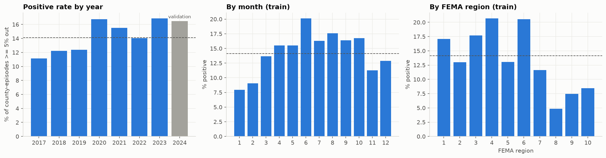

- **Rising over time:** 11.2% in 2017, 16.7% in 2020 and 16.8% in 2023. Validation (2024) sits at 16.5%, above the training average of 14.1% (dashed line).
- **Seasonal:** 8% in January and 20% in June. Summer convective storms do more damage per episode than winter systems.
- **Regional:** FEMA regions 4 (Southeast) and 6 (South Central) are at ~21%; region 8 (Mountain) is at 4.9%. The highest states are LA (37.5%), MS (28.9%), GA (27.4%), ME (25.5%) and WV (25.2%); the lowest are CO (3.1%), WY (3.6%) and DC (1.2%).

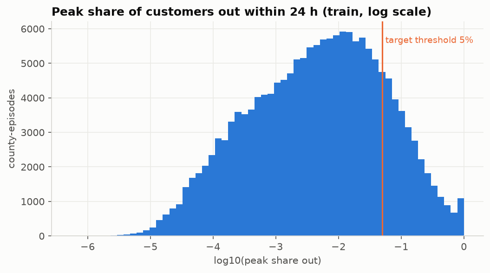

- The label-defining peak has a long tail. **22% of county-episodes have nobody out at all**, 32% reach 1%, 14.1% reach 5% (the target), 8.3% reach 10% and 1.2% reach 50%. **Among positives, the median peak is 11.9%**, so positives are well past the threshold, not borderline.

## 4. What predicts outages: feature–target relationships

### 4.1 Signal of each feature on its own

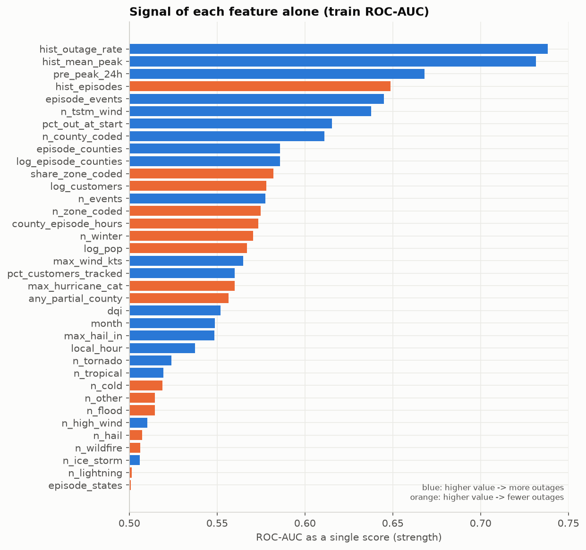

Each bar shows how well one feature, used alone as a score, ranks positives above negatives (ROC-AUC; 0.5 = no signal).

- **History leads:** past outage rate 0.74 and past mean peak 0.73.
- **Then pre-storm conditions** (worst share out in the previous 24 h: 0.67), **storm-system size** (reports in the episode: 0.65), **thunderstorm wind reports** (0.64) and **county-coded reports** (0.61).
- **Inverse signals (orange):** more past episodes, more zone coding, bigger counties and longer activity all mean *lower* risk. Long-lasting, zone-coded winter systems are common but rarely knock out 5% of a county.
- No single feature is near the 0.80 ROC-AUC of the simple "storm family × county history" rule, so **combining features is where a model earns its keep**.

### 4.2 Outage rate across each feature's range

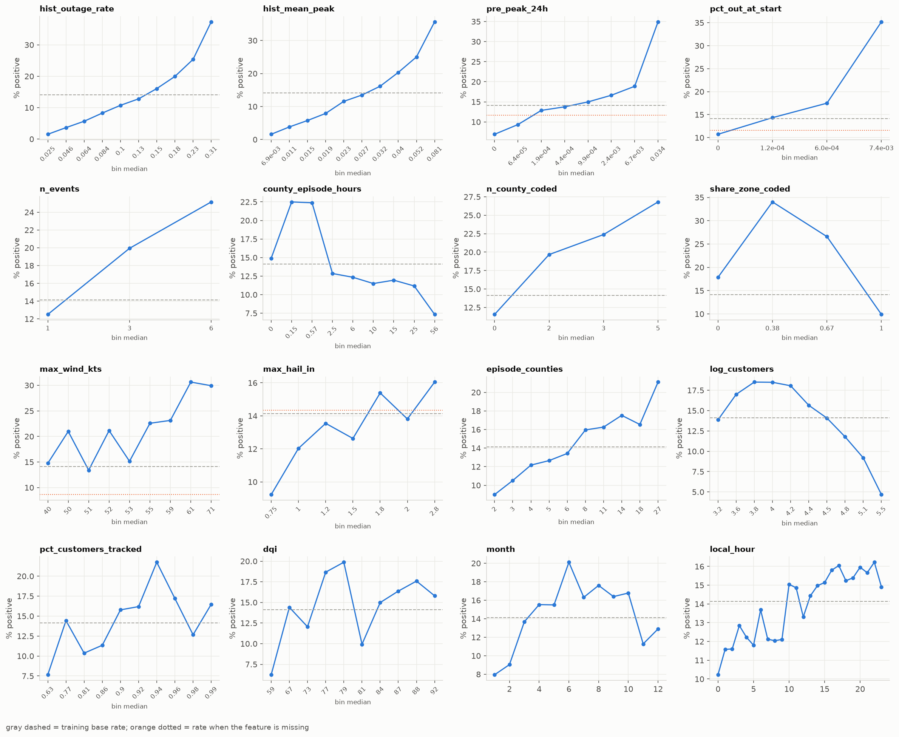

- **History and pre-storm features rise smoothly** and almost linearly. These are good inputs for both logistic regression and boosting.
- **Max wind:** rows with a measured gust of 61+ knots are positive about 30% of the time. Rows **without** a wind report (orange line) are positive only 8.6% of the time.
- **County size has a hump:** small-to-mid counties are highest, the largest are lowest. A linear model needs a transformation to capture this; trees capture it directly.
- **Activity duration is non-monotonic:** short, intense county episodes (under an hour) are most dangerous (22%). Multi-day episodes fall to 7%.
- **Hour of day:** risk climbs from ~10% at midnight to ~16% in the afternoon and evening, following the convective-storm cycle.
- **`dqi` and `pct_customers_tracked` look noisy.** They are region- and state-level quality scores, not storm drivers.

### 4.3 Storm family, storm location coding and pre-storm outages

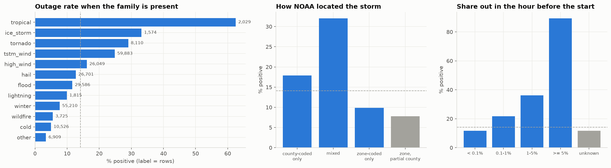

| Storm family present | Rows | % positive |  | Pre-storm share out | Rows | % positive |
|---|---|---|---|---|---|---|
| Tropical | 2,029 | **62.5%** | | < 0.1% | 176,457 | 11.7% |
| Ice storm | 1,574 | 33.2% | | 0.1–1% | 16,697 | 21.7% |
| Tornado | 8,110 | 29.0% | | 1–5% | 5,807 | 36.1% |
| Thunderstorm wind | 59,883 | 24.8% | | ≥ 5% | 2,596 | **89.4%** |
| High wind | 26,049 | 16.2% | | unknown | 6,925 | 11.6% |
| Hail / flood | 26–30 K | 12–13% | | | | |
| Winter / cold / wildfire / other | 3.7–55 K | 3–8% | | | | |

- **Storm family is a strong but blunt feature.** County history alone spans 1.5% to 37% (§4.2), so the same storm type means very different risk in different counties. That's why the reference rule multiplies the two.
- **Zone-coded only: 9.9%. County-coded only: 17.9%. Mixed episodes: 32%.** Mixed episodes are large systems with both kinds of report. Partial-county zones are the weakest (7.8%).
- **Already-out counties (≥5% before the start)** are 1.2% of rows but nearly always positive. The target keeps them on purpose (user decision), and `pct_out_at_start` lets the model recognise them.

## 5. Missing values carry information

| Feature | Missing | % positive when missing | % positive when present | Why it's missing |
|---|---|---|---|---|
| `max_hurricane_cat` | 99.9% | 14.1% | 90.2% | Only hurricanes have a category |
| `max_hail_in` | 87.2% | 14.3% | 12.7% | No hail report in the episode |
| `max_wind_kts` | 59.0% | **8.6%** | **22.1%** | No report with a wind measurement |
| `pre_peak_24h`, `pct_out_at_start` | 3.3% | 11.6% | 14.2% | Day before not observed by EAGLE-I |
| `log_pop` | 0.4% | 11.3% | 14.1% | Connecticut's 8 old counties have no 2023 Census population |

**Implication:** keep "missing" as information. `HistGradientBoostingClassifier` handles it natively; logistic regression gets a missing-flag per feature plus a neutral fill.

## 6. Redundant features

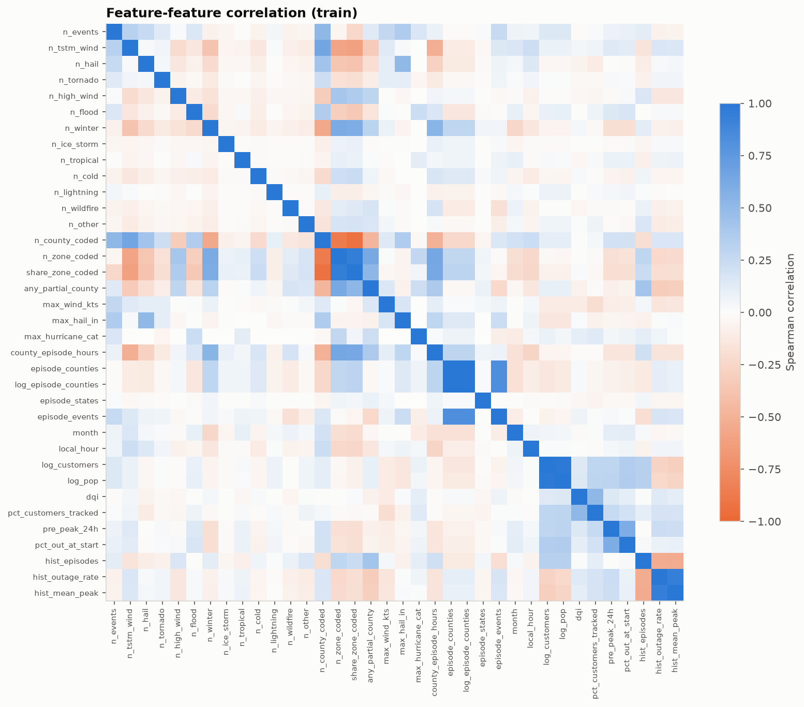

| Feature pair | Spearman ρ | Takeaway |
|---|---|---|
| `episode_counties` · `log_episode_counties` | 1.00 | Same ranking (log transform); keep one for linear models |
| `log_customers` · `log_pop` | 0.98 | Customers ≈ 0.5 × population almost everywhere |
| `n_zone_coded` · `share_zone_coded` | 0.95 | Most episodes are all-zone or all-county |
| `hist_outage_rate` · `hist_mean_peak` | 0.94 | Two views of the same county history |
| `n_county_coded` · `share_zone_coded` | −0.93 | Mirror image of the pair above |

Trees are unaffected. For logistic regression, these pairs inflate coefficient variance, so use regularisation (or drop one of each pair) and don't read coefficients one by one.

## 7. Stability across splits (drift)

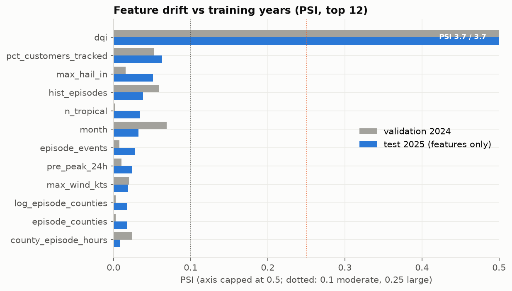

- **Almost every feature is stable:** population stability index < 0.1 for validation and test.
- **`dqi` breaks (PSI 3.7):** the EAGLE-I quality index only exists for 2018–2022, so every 2023–2025 row gets the 2022 regional value. In training it partly encodes the year, and in validation and test it is nearly constant. **Recommendation: leave `dqi` out of the baseline models** (`pct_customers_tracked` has the same mapping but drifts only mildly, PSI 0.06).
- **`hist_episodes`** is ~17% larger in validation and test (7 years of history instead of 6), a known effect of the leave-one-year-out design. It's small (PSI < 0.06), but worth knowing.
- **2025 has almost no tropical activity** (9 rows), so tropical performance can only be judged on validation.

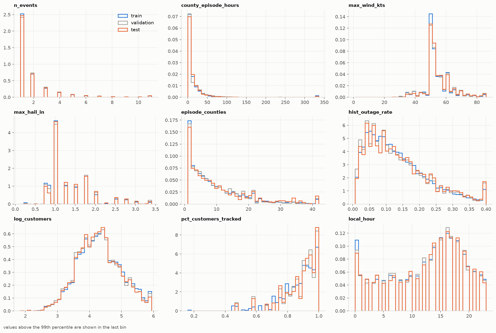

The distributions of the main features overlap closely across train, validation and test. Wind reports cluster at 50 knots, NOAA's severe-wind criterion, so wind speed carries less information than its range suggests.

## 8. Context: outage and storm patterns in the cleaned data (2017–2023)

This EDA ran on the cleaned outage and storm tables *before* the ML-ready table existed. It set the target (≥5% within 24 h), the unit (county × episode) and the triggers. A "significant outage" there is ≥1% out within 24 h of a storm report.

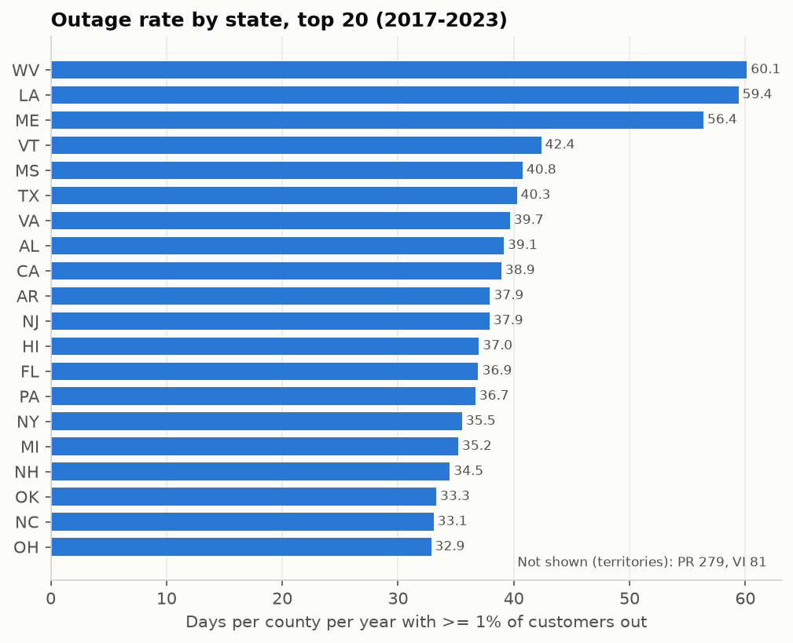

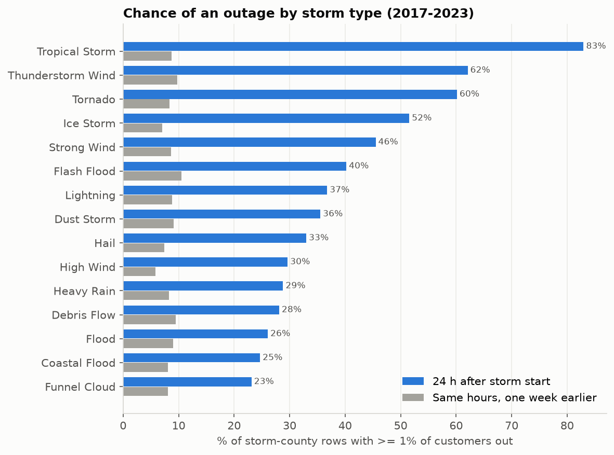

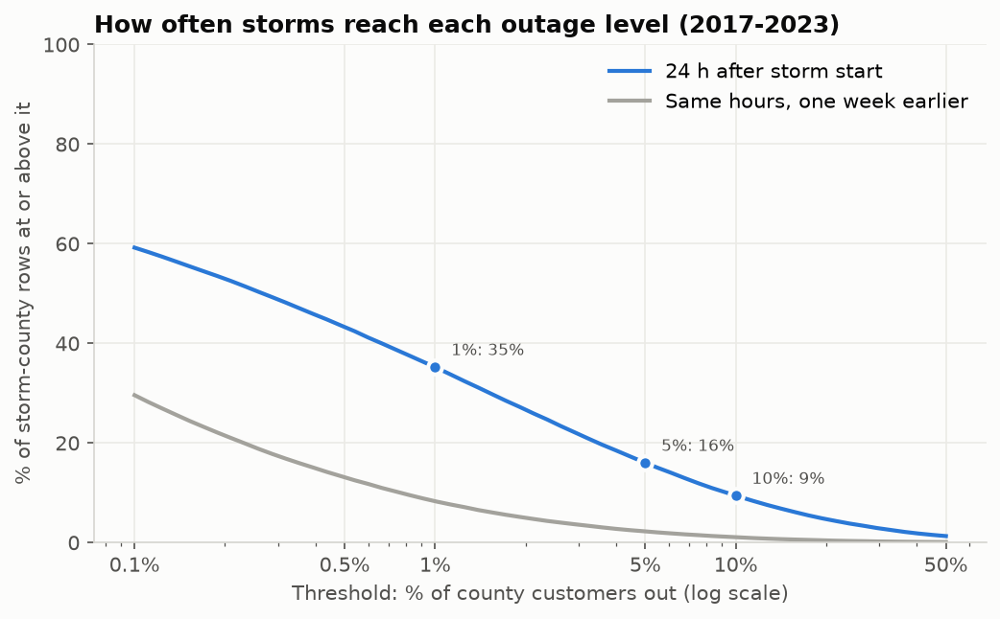

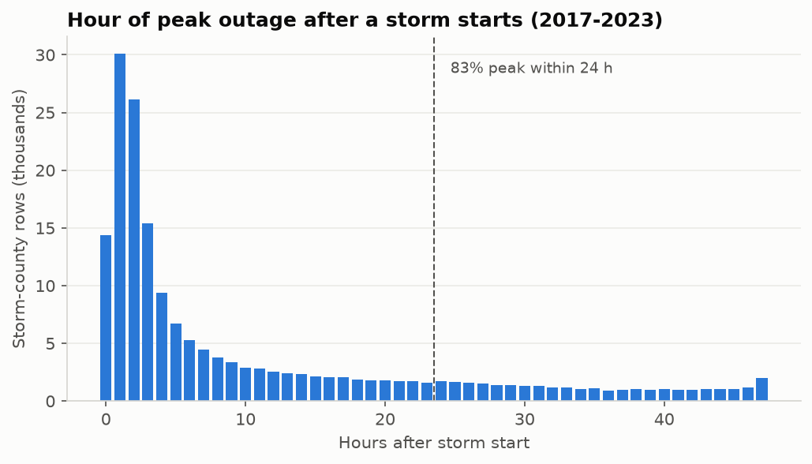

- **Storms multiply outage risk:** 35% of storm × county rows have a ≥1% outage within 24 h, against 8% in the same county and hours one week earlier. At the ≥5% level, the ratio is ~8×.
- **Outages peak fast:** median 4 h after the storm starts, and 83% within 24 h. That's why the window is 24 h.
- **Thresholds:** ≥1% gives 36% positives but more background noise; **≥5% (17%) is a cleaner storm signal**. The project uses 5%.
- **Most outages have no storm record.** Only ~20% of significant outage county-days have a NOAA storm within ±1 day, so the model covers storm-linked outages only.
- **Drought and heat barely differ from a normal week**, so they were dropped as triggers.

## 9. What this means for modeling

| Finding | Modeling choice |
|---|---|
| Rising positive rate, partly from coverage | Check calibration on 2024; time-based splits only |
| History and pre-storm outages are the strongest signals | Keep the leave-one-year-out history; no extra leakage guards needed beyond `retro_*` |
| Non-linear effects (county size hump, duration, wind threshold) | Gradient boosting is the natural main model; logistic regression needs transforms |
| Missing values carry information | Native missing handling (boosting) or missing flags (logistic regression) |
| Near-duplicate feature pairs | Regularise logistic regression; drop one of each pair if needed |
| `dqi` drifts by construction | Recommended: exclude it from the baselines |
| Rows within an episode are dependent | Bootstrap by `episode_id` when comparing models |
| Bar to beat | Storm family rate × county history: 2024 PR-AUC 0.469, ROC-AUC 0.80 (see `reports/success_criteria.md`) |
